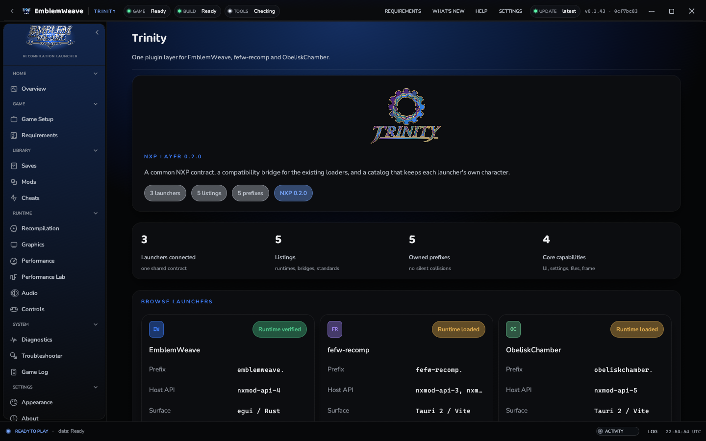
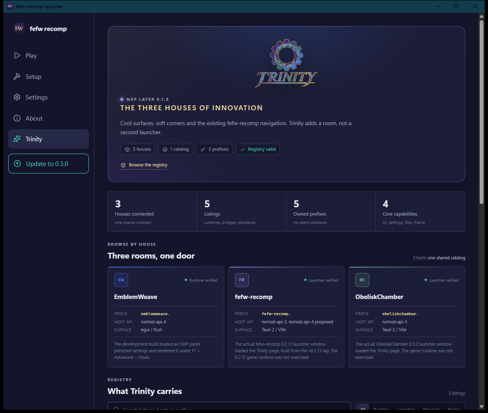
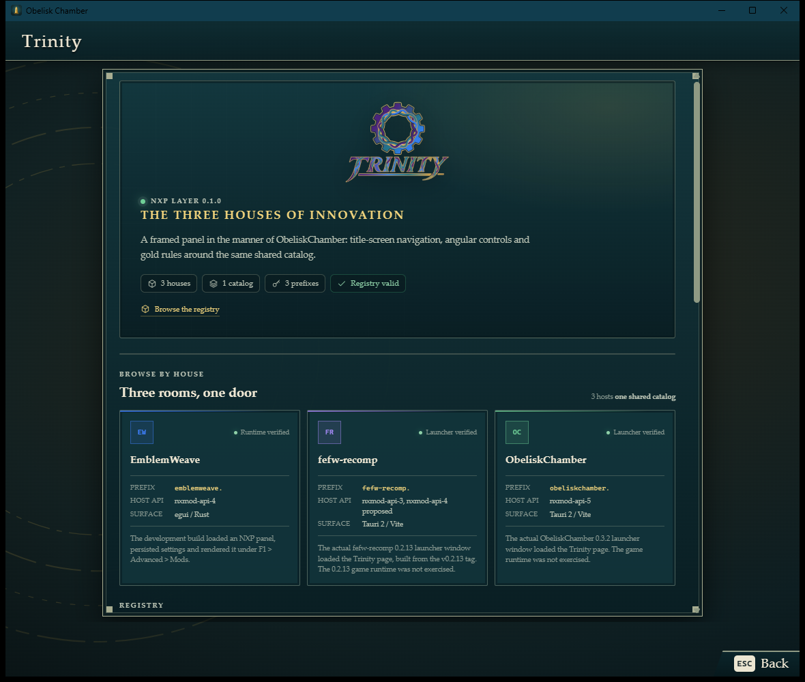

<p align="center">
  
</p>

# Trinity

**Shared plugin layer for EmblemWeave, fefw-recomp and ObeliskChamber.**

Trinity is the shared plugin framework for three independent *Fire Emblem: Fortune's Weave* projects:

- [EmblemWeave](https://github.com/XiONDiGiTaL/EmblemWeave)
- [fefw-recomp](https://github.com/metrist38/fefw-recomp)
- [ObeliskChamber](https://github.com/xinthefreefallxai/ObeliskChamber)

The host applications remain independent. Trinity defines the common contract between them: a versioned C ABI, a compatibility adapter, host-specific integration layers, a shared catalog and a prefix registry for interface names.

This repository is the central development home for that framework. It is not a replacement for any host project.

## The Trinity surface

| EmblemWeave | fefw-recomp | ObeliskChamber |
|:---:|:---:|:---:|
| <a href="docs/evidence/emblemweave-trinity.png"></a> | <a href="docs/evidence/launcher-fefw-trinity.png"></a> | <a href="docs/evidence/launcher-obelisk-trinity.png"></a> |
| Native egui page | Host-styled page | Panel-styled screen |

All three images are captured from actual launcher windows. EmblemWeave used its native release-frame capture; fefw-recomp 0.2.13 and ObeliskChamber 0.3.2 were built with the Trinity page and captured through their Tauri windows. The Tauri launcher integrations remain local and are not merged upstream; the EmblemWeave native page is part of its host tree. [The evidence notes](docs/evidence/README.md) record the exact level of every capture.

## Status

| Area | State |
| --- | --- |
| Public NXP ABI | Implemented, version 1 |
| Compatibility adapter for `NxModApi` | Implemented; loaded and exercised in an EmblemWeave development build and the prepared fefw-recomp 0.2.13 runtime |
| Reference plugin | 0.2.0 built and loaded by the EmblemWeave development runtime and fefw-recomp 0.2.13 alongside two published code mods |
| Host adapters | Native EmblemWeave page plus Tauri pages for fefw-recomp and ObeliskChamber |
| Launcher catalog surface | Native EmblemWeave page plus actual fefw-recomp 0.2.13 and ObeliskChamber 0.3.2 Tauri windows; all three captured |
| fefw-recomp launcher validation | Verified in the actual 0.2.13 window built from the v0.2.13 tag |
| fefw-recomp runtime validation | Verified headless on the prepared update-131072 runtime (API 3): Trinity, Quick Save and Turn Control loaded; no panel or gameplay action |
| ObeliskChamber launcher validation | Verified in the actual 0.3.2 window built from the current source |
| ObeliskChamber runtime validation | Not run; no prepared 0.3.2 game runtime; the installer staged 0.2.0 only |
| Linux build | x64 `libTrinity.so` built, exports checked and loaded by the native `dlopen` harness; no Linux game launcher was available |

Compilation is not loading. Loading is not rendering. Rendering is not gameplay. The support matrix in [docs/COMPATIBILITY.md](docs/COMPATIBILITY.md) records each level separately.

## What is in the repository

| Path | Purpose |
| --- | --- |
| `include/nxp/nxp.h` | The public C ABI. Plugins compile against this header only. |
| `hosts/compat/` | The `NxModApi` compatibility host linked into a plugin DLL. It exports `nxmod_init` for hosts that do not load NXP natively. |
| `plugins/trinity_core/` | The reference Trinity plugin: host discovery, settings, a native panel, a frame hook and the prefix registry. |
| `examples/hello_panel/` | The smallest working NXP plugin. |
| `tests/` | Standalone host harness, manifest tests and prefix tests. |
| `tools/` | Windows build script, release packager, checksum-verified installer and manifest validation. |
| `integrations/` | Sync helper that copies the shared catalog, prefix registry and launcher surface into host checkouts. |
| `shared/` | The canonical catalog and prefix registry shared by launchers and plugins. |
| `ui/` | The shared launcher surface. It supplies content, not a host visual language. |
| `hosts/launchers/` | Host-specific launcher adapters. |
| `docs/` | Architecture, compatibility, migration inventory, proposals and runtime evidence. |
| `assets/brand/` | The authoritative Trinity logo. |

## Design in one page

A plugin exports one function:

```c
const NxpPluginDesc* nxp_get_plugin(uint32_t host_abi_version);
```

The host validates the descriptor, calls `init`, and exposes optional interfaces through `NxpHostApi.get_interface`. The v1 interfaces are:

- `nxp.ui`
- `nxp.settings`
- `nxp.files`
- `nxp.frame`

Every interface table starts with `size` and `version`. Tables grow only at the end. A missing interface is a normal state; the plugin must degrade.

The current compatibility adapter maps NXP onto the existing `NxModApi` table, so no host API version needs to change for the first working plugins. A native host adapter can expose the same `NxpHostApi` directly later. The legacy `nxmod_init` path stays supported throughout the transition.

The launcher and the runtime remain separate processes. Launchers read manifests and manage files. Runtimes validate and load code. A manifest is not a security boundary.

## Prefix registry

Trinity implements the project-prefix idea from [fefw-recomp issue #165](https://github.com/metrist38/fefw-recomp/issues/165) at the shared layer:

| Owner | Canonical prefix | Purpose |
| --- | --- | --- |
| Trinity | `trinity.` | Portable services owned by the shared framework |
| NXP | `nxp.` | The compatibility ABI |
| EmblemWeave | `emblemweave.` | Host-only interfaces and game integrations |
| fefw-recomp | `fefw-recomp.` | Host-only interfaces and game integrations |
| ObeliskChamber | `obeliskchamber.` | Host-only interfaces and game integrations |

Short aliases such as `ew.`, `fefw.` and `oc.` are accepted for input and diagnostics. Canonical names are written to disk. The loader rejects unknown and doubled prefixes. Existing `NxModApi` symbols remain valid; prefixes are added at the interface registry rather than forced onto old entry points.

The machine-readable registry is [shared/prefixes.json](shared/prefixes.json). The portable classifier and its tests are [shared/prefix-core.mjs](shared/prefix-core.mjs) and [shared/prefix-core.test.mjs](shared/prefix-core.test.mjs).

`shared/catalog.json` and `shared/prefixes.json` are canonical. The launcher adapters embed snapshots, and [integrations/sync-trinity.ps1](integrations/sync-trinity.ps1) refreshes them. Re-run the sync after any change to the catalog or registry, then rebuild the host surface.

## Build on Windows

Requirements:

- CMake 3.20 or newer
- Ninja
- Visual Studio 2022 or newer
- The clang-cl and lld-link binaries shipped under `EmblemWeave/tools/bin` in the development workspace

From the workspace root:

```powershell
powershell.exe -NoProfile -ExecutionPolicy Bypass -File Trinity/tools/build-windows.ps1
```

Outputs:

- `Trinity/build/Trinity.dll`
- `Trinity/build/NxpDemo.dll`
- `Trinity/build/nxp_host_test.exe`
- `Trinity/build/nxmod_adapter_test.exe`

The compatibility adapter compiles against the public `nxrt/mod_api.h` and `nxrecomp/ctx.h` headers from an EmblemWeave checkout. Pass `-DNXP_NXMOD_ROOT=<checkout>/engine/fefw-recomp` if the checkout is elsewhere.

A native host implementation needs only `include/nxp/nxp.h`.

## Build and test on Linux

Ninja, CMake and a C++17 compiler are enough. The adapter uses `/proc/self/exe` for host detection; the host harness uses `dlopen`.

```bash
cmake -S . -B build-linux -G Ninja -DCMAKE_BUILD_TYPE=Release \
  -DNXP_NXMOD_ROOT=../EmblemWeave/engine/fefw-recomp
cmake --build build-linux
ctest --test-dir build-linux --output-on-failure
./build-linux/nxp_host_test ./build-linux/libTrinity.so trinity
```

The Linux output is an ELF64 x86-64 shared object. `readelf -h`, `nm -D` and `ldd` are part of the verification; a renamed DLL is not a Linux build. There is no Linux game runtime in this workspace, so the Linux claim stops at native loading. See [docs/COMPATIBILITY.md](docs/COMPATIBILITY.md).

## Test

```powershell
ctest --test-dir Trinity/build --output-on-failure
node --test Trinity/shared/prefix-core.test.mjs
python Trinity/tools/validate_plugin.py Trinity/plugins/trinity_core/plugin.json
python -m unittest discover -s Trinity/tests -p "test_*.py"
```

The C++ harness loads the plugin, supplies an NXP host with all four interfaces, checks discovery and panel registration, exercises settings and reset, runs the frame callback, calls shutdown and checks the final flush. Three more CTest cases run the compatibility adapter against simulated `NxModApi` 3, 4 and 5 tables. The same five tests pass on Windows and Linux.

The EmblemWeave runtime path is documented in [docs/COMPATIBILITY.md](docs/COMPATIBILITY.md) and [docs/INSTALL.md](docs/INSTALL.md). The development runtime loaded Trinity 0.2.0, [Quick Save](https://gamebanana.com/mods/742827) 1.0.0 and [Turn Control](https://gamebanana.com/mods/745602) 0.3.0 together; the first two are native `NxModApi` plugins and do not pass through Trinity's adapter. The same three original DLLs also loaded in the prepared fefw-recomp 0.2.13 runtime (API 3) and reached the first frame; that run was headless and performed no gameplay action. See [docs/evidence/fefw-runtime.log](docs/evidence/fefw-runtime.log). Loading is not gameplay.

## Documentation

- [Architecture](docs/ARCHITECTURE.md)
- [Install and release assets](docs/INSTALL.md)
- [Release 0.2.0 notes](docs/RELEASE-0.2.0.md)
- [Compatibility matrix](docs/COMPATIBILITY.md)
- [Development inventory and migration record](docs/INVENTORY.md)
- [NXP ABI guide](docs/NXP.md)
- [Prefix specification](docs/PREFIXES.md)
- [Technical assessment](docs/ASSESSMENT.md)
- [Maintainer proposal](docs/PROPOSAL.md)
- [Test evidence](docs/evidence/README.md)
- [Brand assets](assets/brand/README.md)

## Licensing

The repository is MIT licensed as established by its owner. The NXP header, the compatibility adapter and the reference plugin carry `GPL-3.0-or-later`, matching the host projects from which their ABI is derived. Third-party and host-derived material is listed in [docs/THIRD_PARTY.md](docs/THIRD_PARTY.md). Do not remove an SPDX identifier from a migrated file.

## Contributing

The three host projects remain independent. Changes to a host repository require that host's maintainers and its own review process. Trinity changes belong here.

Do not claim support for a host or a platform without a matching entry in the compatibility matrix and evidence for the exact level claimed.

Independent launchers, one shared plugin layer.
