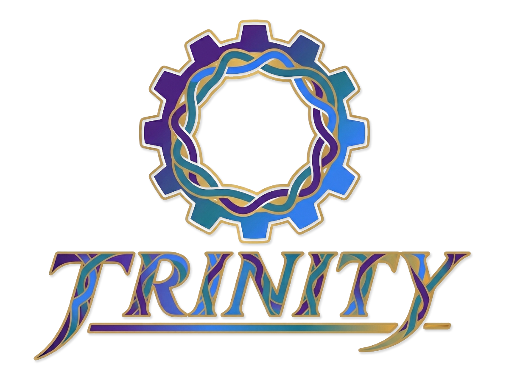

<p align="center">
  
</p>

# Trinity

### Unified Code Mods Plugin

**Three Houses. One Vision.**

Trinity is a unified code-mod plugin for three independent *Fire Emblem: Fortune's Weave* projects:

- [EmblemWeave](https://github.com/XiONDiGiTaL/EmblemWeave)
- [fefw-recomp](https://github.com/metrist38/fefw-recomp)
- [ObeliskChamber](https://github.com/xinthefreefallxai/ObeliskChamber)

It provides a shared code-mod compatibility layer and plugin interface, so a compatible code mod can target one contract instead of maintaining a separate implementation for every launcher. Each launcher keeps its own design, functionality and identity. Trinity connects their code-mod systems through a shared interface and host-specific integration.

Trinity is not a replacement launcher, a mod manager or a fork of any host project.

## What Trinity provides

| Capability | What it means for a code mod |
| --- | --- |
| One plugin interface | A versioned C ABI (`NXP`) with a single discovery entry point and optional interfaces for host identity, settings, files, frames and a native panel. |
| Existing mod compatibility | A compatibility adapter maps the `NxModApi` 3, 4 and 5 tables that the three runtimes already expose. Existing `nxmod_init` mods keep loading; no host API version has to change. |
| Host-owned interface | The plugin supplies content; the host draws it with its own fonts, spacing, colours, input model and controller navigation. Each launcher remains visually itself. |
| Shared services | Persisted per-plugin settings, plugin-scoped files and an optional per-frame callback, with capability checks so a plugin degrades cleanly when a host lacks an interface. |
| Collision-free names | A prefix registry reserves `trinity.`, `nxp.` and each host's namespace, and rejects unknown or doubled prefixes at load time. |
| Prebuilt releases | Windows x64 `Trinity.dll` and Linux x64 `libTrinity.so`, published with `SHA256SUMS` and a dependency-free installer. Launcher developers do not need to build Trinity to consume it. |
| Evidence-based support | The compatibility matrix records the exact level reached for each host: compiled, loaded, observed, visually inspected or gameplay-tested. |

The compatibility adapter is the bridge that makes current hosts work without a runtime rewrite. A native host adapter can expose the same NXP contract directly later. See [docs/NXP.md](docs/NXP.md) and [docs/ARCHITECTURE.md](docs/ARCHITECTURE.md).

## Supported launcher projects

| Project | Launcher | Code-mod API at the tested version | Trinity integration |
| --- | --- | --- | --- |
| [EmblemWeave](https://github.com/XiONDiGiTaL/EmblemWeave) | Native egui / Rust | `NxModApi` 4 | Native Trinity page in the host tree; NXP compatibility adapter loaded by the development runtime and the Trinity panel registered. |
| [fefw-recomp](https://github.com/metrist38/fefw-recomp) | Tauri 2 / Vite | `NxModApi` 3 in 0.2.13; API 4 planned upstream | Host-styled Tauri page adapter and patch; Trinity Core 0.2.0 loaded headless on API 3, where no panel slot exists. |
| [ObeliskChamber](https://github.com/xinthefreefallxai/ObeliskChamber) | Tauri 2 / Vite | `NxModApi` 5 | Panel-styled Tauri page adapter and patch; Trinity Core 0.2.0 loaded headless on API 5 and registered its panel. |

The launcher and the game runtime are separate processes. Trinity's launcher surface presents the shared catalog and prefix registry; the runtime plugin provides the interfaces. A launcher page does not prove that a plugin loads, and a plugin load does not prove gameplay.

## Compatibility status

| Host | Verified | Not yet verified |
| --- | --- | --- |
| EmblemWeave (development runtime, API 4) | Windows x64 DLL loaded and initialized alongside two published code mods; demo panel rendered under F1 > Advanced > Mods; Trinity panel registration and prefix checks logged; settings persisted through the adapter. | A windowed capture of the Trinity 0.2.0 panel; any save, turn or gameplay action. |
| fefw-recomp 0.2.13 (API 3) | Windows x64 DLL loaded and initialized headless with the same two published mods; first frame reached; settings files created. | A panel (API 3 has no `add_panel` slot); any save, turn or gameplay action. |
| ObeliskChamber 0.3.2 (API 5) | Windows x64 DLL loaded and initialized headless with the same two published mods; panel registered; first frame reached. | Drawing or interacting with the panel; any save, turn or gameplay action. |
| Linux x64 | `libTrinity.so` builds as ELF64 x86-64, exports both entry points and passes the native `dlopen` host harness. | Any Linux game launcher or game runtime; Steam Deck and Proton are untested. |

Compilation is not loading. Loading is not rendering. Rendering is not gameplay. The full evidence ledger is in [docs/COMPATIBILITY.md](docs/COMPATIBILITY.md).

## Installation and downloads

The current release is [Trinity 0.2.0](https://github.com/XiONDiGiTaL/Trinity/releases/tag/v0.2.0).

| Platform | Release asset | Payload |
| --- | --- | --- |
| Windows x64 | `Trinity-v0.2.0-windows-x64.zip` | `TrinityCore/exefs/Trinity.dll` |
| Linux x64 | `Trinity-v0.2.0-linux-x64.tar.gz` | `TrinityCore/lib/libTrinity.so` and `include/nxp/nxp.h` |

`SHA256SUMS` and `release.json` sit beside the archives. Verify the archive before extracting; the installer does this automatically. End users do not need Visual Studio, CMake, a compiler, an SDK or any other development tool to install Trinity.

For fefw-recomp and ObeliskChamber, the dependency-free installer writes only `<host>/mods/TrinityCore`:

```powershell
python tools/install_trinity.py --host-dir "C:\path\to\fefw-recomp" --version 0.2.0
python tools/install_trinity.py --host-dir "C:\path\to\ObeliskChamber" --version 0.2.0
```

For EmblemWeave, builds that include the integration embed the Windows payload and install `TrinityCore` under `data/play/mods` (or `%APPDATA%\EmblemWeave\play\mods`) on first start. Existing settings are preserved across updates.

Release archives, offline installation, host bundles and checksum verification are documented in [docs/INSTALL.md](docs/INSTALL.md).

## Existing code mod compatibility

Trinity is tested alongside the original binaries of two published code mods. They use `NxModApi` directly and do not pass through Trinity's NXP adapter; the result is coexistence under the same host loader, not a claim that they are NXP plugins.

| Mod | EmblemWeave (API 4) | fefw-recomp 0.2.13 (API 3) | ObeliskChamber 0.3.2 (API 5) |
| --- | --- | --- | --- |
| [Quicksave 1.0.0](https://gamebanana.com/mods/745602) | Loaded; `[Quick] ready`; found its save folder. No save or load action exercised. | Loaded; `[Quick] ready`; save folder not found in the headless profile. No save or load action exercised. | Loaded; `[Quick] ready`; save folder not found in the headless profile. No save or load action exercised. |
| [Turn Control 0.3.0](https://gamebanana.com/mods/742827) | Loaded; `[Turns] ready`; Mods window and hotkeys available. No turn or facility action exercised. | Loaded; `[Turns] ready`; System submenu registered. No turn or facility action exercised. | Loaded; `[Turns] ready`; Turn Control list screen registered. No turn or facility action exercised. |

Both mods and Trinity Core loaded together in every host above, with no init declined. The runs were headless; they prove loading and initialization, not save, turn or gameplay behavior. See [docs/evidence/](docs/evidence/) for the logs and exact hashes.

These are also the reference mods used to check that Trinity does not disturb an existing code-mod ecosystem. See [Credits & Contributors](#credits--contributors).

## Platform support

| Platform | Artifact | Architecture | Runtime dependencies | Verified level |
| --- | --- | --- | --- | --- |
| Windows | `Trinity.dll` | PE32+ x86-64 | No third-party libraries. Uses the x64 Microsoft C/C++ runtime; a host system without it needs the standard VC++ Redistributable. | Built; loaded by EmblemWeave, fefw-recomp 0.2.13 and ObeliskChamber 0.3.2 game runtimes. |
| Linux | `libTrinity.so` | ELF64 x86-64 | The standard x86-64 C/C++ runtime already present on desktop distributions (`libstdc++`, `libgcc_s`, `libc`). No third-party libraries. | Built; ELF and exports checked; loaded by the native `dlopen` harness. No Linux game host was tested. |

`Trinity.dll` and `libTrinity.so` are different binary formats. Renaming one does not produce the other. Build the matching artifact for the platform and load it with that platform's module loader.

Steam Deck and Proton compatibility have not been validated. The Linux result is a native harness result, not a Linux game launch.

## For launcher maintainers

Other launcher projects can consume Trinity without building it:

1. Bundle a verified release payload, or download an official release and verify it against `SHA256SUMS`.
2. Place `TrinityCore` where the host's existing mod loader already scans (`mods/` for fefw-recomp and ObeliskChamber; `data/play/mods/` for EmblemWeave).
3. Let the existing loader call `nxmod_init`, or resolve `nxp_get_plugin` from a native adapter.
4. Validate `plugin.json`, the NXP descriptor and the host's capability set before enabling UI.
5. Preserve the launcher's current pages, navigation and visual language; add Trinity as one entry rather than replacing the shell.
6. Report a missing or incompatible plugin as a disabled entry with a useful reason, not as a launcher crash.

The practical guide, including version checks, update handling, error messages and host-specific load paths, is [docs/HOST-INTEGRATION.md](docs/HOST-INTEGRATION.md). It requires no build step in the host project beyond its normal packaging.

## Documentation

| Document | Purpose |
| --- | --- |
| [Launcher integration](docs/HOST-INTEGRATION.md) | Bundling, downloading, verifying, loading, version checks, updates and error handling for host maintainers. |
| [Install and release assets](docs/INSTALL.md) | End-user installation, offline bundles and platform artifacts. |
| [Compatibility matrix](docs/COMPATIBILITY.md) | Exact host and platform status with evidence levels. |
| [Architecture](docs/ARCHITECTURE.md) | Layers, lifecycle, threading and the launcher/runtime split. |
| [NXP ABI guide](docs/NXP.md) | The public plugin contract, interfaces and rules for native adapters. |
| [Prefix specification](docs/PREFIXES.md) | The shared namespace registry and its relationship to fefw-recomp issue #165. |
| [Building and testing](docs/BUILDING.md) | Contributor build and test instructions for Windows and Linux. |
| [Release 0.2.0 notes](docs/RELEASE-0.2.0.md) | What changed in the current release. |
| [Test evidence](docs/evidence/README.md) | Runtime logs, launcher captures and their limits. |
| [Licensing and provenance](docs/THIRD_PARTY.md) | License scope and third-party attribution. |
| [Development inventory](docs/INVENTORY.md) | What existed before Trinity and what was migrated. |
| [Technical assessment](docs/ASSESSMENT.md) | Phase 0 assessment, retained as a historical record. |
| [Maintainer proposal](docs/PROPOSAL.md) | Early proposal, not posted and not accepted. |
| [Brand assets](assets/brand/README.md) | The authoritative Trinity logo. |

## Credits & Contributors

Trinity exists because three independent launcher projects chose to share a code-mod surface, and because contributors made that surface testable against real mods. Listing a project here credits the person who leads it; it does not imply that everyone below authored Trinity itself.

| Contributor | Project / contribution | Links |
| --- | --- | --- |
| [**XiØN**](https://github.com/XiONDiGiTaL) | EmblemWeave | [EmblemWeave](https://github.com/XiONDiGiTaL/EmblemWeave)  |
| [**metrist38**](https://github.com/metrist38) | fefw-recomp | [fefw-recomp](https://github.com/metrist38/fefw-recomp) |
| [**xinthefreefallx**](https://github.com/xinthefreefallxai) | ObeliskChamber | [ObeliskChamber](https://github.com/xinthefreefallxai/ObeliskChamber) |
| [**Mi-Kel**](https://github.com/Mi-Kel) | Pull request contributions and code mods used for compatibility testing | [Code Mods](https://gamebanana.com/members/submissions/sublog/316123) |

**Mi-Kel** contributed the merged [EmblemWeave pull request #71](https://github.com/XiONDiGiTaL/EmblemWeave/pull/71), which added the `NxModApi` 4 Mods window for code mods' own settings (keyboard F8, controller through the menu's Mods tab). Mi-Kel also provided the code mods used as compatibility references: [Quicksave 1.0.0](https://gamebanana.com/mods/745602) and [Turn Control 0.3.0](https://gamebanana.com/mods/742827), published on GameBanana as `dg^` through the linked submissions page. Those original binaries are what Trinity's coexistence tests load; they are not Trinity plugins.

Mi-Kel is not a maintainer of EmblemWeave, fefw-recomp or ObeliskChamber. The three launcher projects remain their own work, and Trinity's plugin layer, ABI, adapters and launcher surface are maintained in this repository. The credits above do not make all four contributors authors of Trinity.

## Project philosophy

Three projects, three identities, one shared code-mod contract. Trinity does not flatten the launchers into one interface or ask them to adopt a common shell. It gives compatible mods a stable place to stand while each host keeps its own design, input model and release path.

Support is claimed only at the level that was tested. A build is not a load, a load is not a render, and a render is not gameplay. The [compatibility matrix](docs/COMPATIBILITY.md) is the public claim; new evidence appends to it rather than replacing a lower level with a hopeful one.

**Three Houses. One Vision.**

*Independent projects, shared innovation, weaved together.*

## License

The repository is MIT licensed as established by its owner. The NXP header, the compatibility adapter and the reference plugin carry `GPL-3.0-or-later`, matching the host projects from which their ABI is derived. Third-party and host-derived material is listed in [docs/THIRD_PARTY.md](docs/THIRD_PARTY.md). Do not remove an SPDX identifier from a migrated file.

## Contributing

The three host projects remain independent. Changes to a host repository require that host's maintainers and its own review process. Trinity changes belong here.

Do not claim support for a host or a platform without a matching entry in [docs/COMPATIBILITY.md](docs/COMPATIBILITY.md) and evidence for the exact level claimed.
