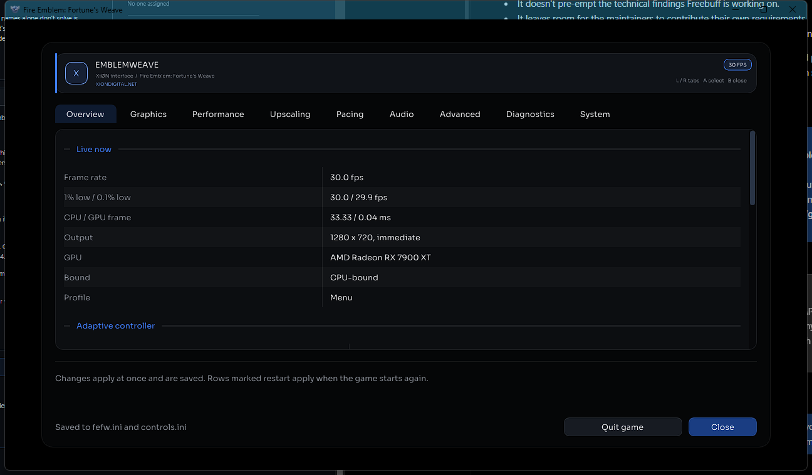
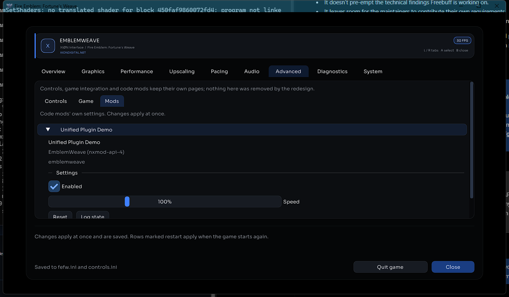

# Unified plugin ecosystem: technical assessment

> Historical record, migrated from the predecessor `unified-plugin-sdk` workspace on 25 November 2026. It describes the phase 0 investigation before the Trinity repository was established. Paths such as `unified-plugin-sdk/` refer to that earlier workspace. Current compatibility status is in [COMPATIBILITY.md](COMPATIBILITY.md); current paths are in [NXP.md](NXP.md).

Date: 25 November 2026

Scope: EmblemWeave, fefw-recomp 0.2.13 and ObeliskChamber 0.3.2.

Status at phase 0 (superseded by [COMPATIBILITY.md](COMPATIBILITY.md)): a
working NXP plugin and compatibility adapter existed. At that point the only
runtime-validated host was EmblemWeave's development build; the packaged
fefw-recomp and ObeliskChamber runtimes had been inspected, not executed. Later
headless runs loaded the same plugin in both of those runtimes.

## Verification labels

Every claim below uses one of these labels:

| Label | Meaning |
| --- | --- |
| S | Read from source code, public headers or repository files. |
| P | Read from the packaged binary with file inspection or string search. |
| C | Compiled successfully in this workspace. |
| L | Loaded by a host and reported by the host as loaded. |
| R | Observed at runtime through logs, settings or UI interaction. |
| V | Visually inspected in a captured host window. |
| N | Not tested, or not testable with the local packages. |

Compilation is not loading. Loading is not rendering. Rendering is not gameplay.
The report keeps those distinctions.

## Executive summary

The shared-SDK approach is feasible at the source and ABI level. All three
projects already expose the same kind of C table, load DLLs from a mod's
`exefs` folder, call `nxmod_init`, support the same three hook-site kinds, and
share the same `.sites` syntax. That is enough to build one plugin source and,
for the common feature set, one Windows x64 DLL per ABI.

The working prototype confirms the foundation in one host:

- A plugin DLL exports `nxp_get_plugin` and `nxmod_init`.
- EmblemWeave's development build loads it and calls the legacy entry point.
- The adapter detects the host, exposes capabilities and four optional
  interfaces, persists settings, registers a native panel, and forwards frame
  callbacks.
- The F1 menu renders the panel with the host's own ImGui styling.
- Clicking the checkbox and slider changed the persisted settings file.

This is not yet a cross-host ecosystem. The installed EmblemWeave executable is
too old to load code mods; the real test used a newer development build. The
fefw-recomp and ObeliskChamber packages have no source checkout and no prepared
game here, so they were not loaded. There is no gameplay interface, no launcher
integration, no Linux build and no in-process unload.

The recommended path is to keep `NxModApi` unchanged for phase 0, use the NXP
compatibility adapter as the bridge, then add native host adapters and align the
lookup mechanism with the version 6 proposal in fefw-recomp issue #165. Do not
change host API version numbers or claim maintainer agreement until the
maintainers accept a concrete proposal.

## 1. Local state and evidence

### 1.1 EmblemWeave

| Item | Value |
| --- | --- |
| Repository | `EmblemWeave/` |
| Branch | `main` |
| Commit | `c302f0abc73c4d1afa13f75ae1462bbe4cacb058` |
| Working tree | One untracked directory: `engine/fefw-recomp/runtime/build_full/` |
| Remotes | `origin` GitHub, `gitlab`, `gitgud`, `metrist` |
| Runtime header | `NXMOD_API_VERSION 4` |
| Launcher | Rust application under `apps/emblemweave` |
| Installed play exe | `%APPDATA%\EmblemWeave\play\fefw.exe`, 220,880,384 bytes, 15 November 2026 |
| Installed exe code-mod support | No `nxmod_init` string, no code-mod UI strings in the inspected binary |
| Development exe | `engine/fefw-recomp/game-build/fefw/build/release/fefw.exe`, 169,853,440 bytes, 25 November 2026 |
| Development exe code-mod support | Loaded `nxmod_init` and the NXP demo |

The installed executable is the one a normal user would launch. The working
plugin test did not use it. The newer development executable was used because
it contains the code-mod loader from the current source. This is a deployment
gap, not a source-design gap.

No EmblemWeave source or executable was modified. The only untracked build
directory predates this task and was preserved.

Source files inspected:

- `runtime/include/nxrt/mod_api.h`: API version 4, table layout, hooks,
  `call_guest`, file editing, panels.
- `runtime/include/nxrt/mod_panels.h`: panel registry types.
- `runtime/src/services/mods_dll.cpp`: DLL loading, `nxmod_early`,
  `nxmod_init`, panel registration, panel visibility, frame callbacks.
- `runtime/src/services/common.cpp`: mod folder discovery and `_`/`-` disable
  convention.
- `runtime/src/gfx/overlay.cpp`: `NxModUi` implementation and
  `draw_mod_panels`.
- `runtime/games/fefw/fefw_menu.cpp`: F1 menu tabs and the
  Advanced > Mods page.
- `apps/emblemweave/src/mods.rs`: launcher discovery, `emblemweave.json`,
  enable/disable by folder rename.
- `apps/emblemweave/src/sites.rs`: `.sites` parser, three kinds, `@nsobid`.

### 1.2 fefw-recomp 0.2.13

| Item | Value |
| --- | --- |
| Path | `X:\fefw-recomp-0.2.13` |
| Version | 0.2.13, Windows 64-bit, per `README.txt` |
| Git metadata | None |
| Runtime | `fefw_rt.dll`, 14,287,360 bytes |
| SHA-256 | `242501d02a91584b260d17cf3dc5be193a46a73492a43b462cf0c6eca127f6fa` |
| Launcher | `fefw-launcher.exe` |
| Launcher manifest | `recomplauncher.json` with `folders.mods = {install}/mods` |
| Build tool | `tools/build/fefw_build.py` |
| `MOD_SITE_KINDS` | `inline`, `midhook`, `entryhook` |
| Unknown site kind | Build failure with an explicit message |
| `nxmod_init` string | Present |
| `nxmod_early` string | Present |
| `add_panel` string | Absent |
| `panel_visible` string | Absent |

Issue #165 states that fefw-recomp is API version 3, with version 4 in the next
release. The local binary is consistent with that: it has the pre-panel entry
points and no panel string. String absence alone is not a complete API probe,
but it agrees with the public issue table. The package contains no headers or
source checkout with which to compile an adapter.

`recomplauncher.json` declares the mods folder, saves and log locations, and a
launcher settings schema. It is launcher metadata, not plugin metadata.

### 1.3 ObeliskChamber 0.3.2

| Item | Value |
| --- | --- |
| Path | `X:\ObeliskChamber-0.3.2` |
| Version | 0.3.2, Windows 64-bit, per `README.txt` |
| Git metadata | None |
| Runtime | `fefw_rt.dll`, 12,184,576 bytes |
| SHA-256 | `091f84783780fa9019dea95db5ca9ec002c62cd9b47d640fe0fe4434bedf9842` |
| Launcher | `ObeliskChamber-launcher.exe` |
| Build tool | `tools/build/fefw_build.py` |
| `MOD_SITE_KINDS` | `inline`, `midhook`, `entryhook` |
| Unknown site kind | Build failure with an explicit message |
| `nxmod_init` string | Present |
| `nxmod_early` string | Present |
| `add_panel` string | Present |
| `panel_visible` string | Absent |

Issue #165 states that ObeliskChamber is API version 5, that `open_list` occupies
the same table slot as the other ports' `add_panel`, and that the runtime tells
them apart by the first argument. The local binary contains `add_panel`, but
the absence of a `panel_visible` string does not prove the table lacks it. The
exact v5 layout was not verified locally. A runtime probe is required before
claiming NXP UI support there.

No `recomplauncher.json` was visible in the package root. That does not prove
the launcher has no equivalent metadata; it was not present in the inspected
file list.

### 1.4 Reverse-engineering resources

`X:\REA` contains Ghidra 12.1 PUBLIC. It was not used. Source, public headers,
build scripts and issue #165 answered the questions needed for phase 0. No
binary was patched, and no speculative binary finding is part of this report.

Ghidra remains appropriate for specific unresolved questions:

- The exact API table layout of ObeliskChamber 0.3.2.
- Whether a packaged runtime calls `get_interface` from `nxmod_early`.
- Undocumented panel or list arguments in a binary-only host.
- A calling-convention mismatch that source cannot explain.

Any such finding should record the binary hash, version, address/function and
confidence. It should not lead to a binary patch.

### 1.5 Issue #165 context

Issue #165 is a live cross-project proposal, not an accepted specification. Its
current public state, as read on 25 November 2026:

- fefw-recomp: API 3, with version 4 in the next release.
- EmblemWeave: API 4.
- ObeliskChamber: API 5.
- fefw-recomp and EmblemWeave have `add_panel`; ObeliskChamber has
  `open_list` in the same slot and distinguishes panel calls by the first
  argument.
- The participants agree that requiring version 5 for `open_list` is fragile.
- fefw-recomp opened PR #170 to make an `open_list` call into `add_panel`
  return 0, so version 4 mods fail safely.
- The proposed version 6 adds one `get_interface(name, version)` member at the
  end of `NxModApi`. Interface tables start with `size` and `version` and grow
  only at the end. Names are ASCII and case-sensitive. Experimental names use a
  project prefix. The lookup would work from `nxmod_early`.
- `open_list` would become `obeliskchamber.list` version 1.
- The proposal is not implemented in all three hosts and is not accepted as a
  final specification.

NXP adopts the same lookup pattern, but at the NXP host layer. It does not
change `NxModApi` and does not claim the issue's version 6 exists. Section 4
explains how the two should converge.

## 2. Comparison of the three implementations

| Area | EmblemWeave | fefw-recomp 0.2.13 | ObeliskChamber 0.3.2 |
| --- | --- | --- | --- |
| Source available locally | Yes, Git checkout | No, binary package | No, binary package |
| Runtime language | C++ | C++ binary | C++ binary |
| Launcher | Rust | `fefw-launcher.exe` | `ObeliskChamber-launcher.exe` |
| Mod entry | `nxmod_init`, optional `nxmod_early` | Same | Same |
| API version | 4 | 3 per issue #165; 4 next | 5 per issue #165 |
| Panel API | `add_panel`, `panel_visible` | None in this package | `add_panel` present; `open_list` shares slot |
| UI framework | ImGui F1 menu | Runtime binary; panel API absent | Runtime binary; panel API present |
| Settings service | None in `NxModApi` | None in `NxModApi` | None in `NxModApi` |
| File service | Raw host paths, `read_file`/`write_file` | Same in v3 | Same in v3+ |
| Hook sites | inline, midhook, entryhook | inline, midhook, entryhook | inline, midhook, entryhook |
| Site list | `.sites`, `@nsobid` | `.sites`, `@nsobid` | `.sites`, `@nsobid` |
| Unknown site kind | Build error | Build error | Build error |
| File edits | `edit_file`, v3 | `edit_file`, v3 | `edit_file`, v3+ |
| Frame callback | `on_frame` | `on_frame` | `on_frame` |
| Guest calls | `call_guest` | `call_guest` | `call_guest` |
| Mod discovery | `<mods>/<name>/exefs/*.dll` | `<install>/mods/<name>/exefs/*.dll` | `<install>/mods/<name>/exefs/*.dll` |
| Disable convention | Folder name starts with `_` or `-` | Same in runtime | Same in runtime |
| Mod metadata | `emblemweave.json` | No common per-mod manifest observed | No common per-mod manifest observed |
| Unload | Never; DLL stays loaded | Never | Never |
| Threading | `nxmod_init` on main; panels on presenting thread | Same model | Same model |

### 2.1 What is genuinely reusable

- The `NxModApi` table is already a stable, append-only C table with version
  and size checks. It is a good compatibility substrate.
- The loader contract is shared: a DLL in a mod's `exefs`, `nxmod_init` at the
  first frame, optional `nxmod_early`, no unload.
- Hook sites, `call_guest`, guest memory access and `edit_file` are shared
  concepts, even where exact implementations differ.
- `.sites` files are effectively identical across the three projects: three
  kinds and an `@nsobid` line.
- The mods folder layout and the `_`/`-` disable convention are already shared.
- All three projects use GPL-3.0-or-later, so a shared GPL SDK is compatible.

### 2.2 What diverges

- Version numbers and table contents. A v3 host has no panels, a v4 host has
  `add_panel`/`panel_visible`, and a v5 host may have `open_list` in the same
  slot.
- Launcher technology and metadata. EmblemWeave uses Rust and
  `emblemweave.json`; fefw-recomp uses `recomplauncher.json`; the packaged
  ObeliskChamber launcher was not inspected at source level.
- UI availability and styling. Only EmblemWeave source was available to verify
  the panel path. fefw-recomp 0.2.13 has no panel API; ObeliskChamber has a
  panel-capable binary but was not run.
- Settings and file scoping. No host provides a common settings service or a
  plugin-scoped file API. `read_file`/`write_file` accept host paths.
- Dependency and load-order handling. The runtime sorts mod folders by name and
  loads DLLs in name order. There is no dependency resolver.
- Error reporting. A plugin can log, but there is no structured diagnostics
  interface or error object.
- Compiler and runtime compatibility. The packages are Windows x64 binaries;
  the plugin was built with clang-cl 23.1.5 and loaded into one development
  host. That does not prove that the same DLL loads in the packaged fefw or
  ObeliskChamber runtimes.

### 2.3 Consequences

The common feature set is real, but it is narrower than the three projects'
total feature set. A single plugin source can target lifecycle, logging,
settings, files, panels and frame callbacks. A single binary is plausible for
Windows x64 because the boundary is C and the adapter compiles against one
header. It is not established for gameplay hooks, because those depend on the
host's `NxModApi` and guest addresses.

A plugin that needs gameplay must either:

- use an optional NXP gameplay interface that a host implements, or
- use a compatibility interface that exposes the host's `NxModApi` under a
  capability, or
- accept that it is a host-specific plugin.

NXP v1 deliberately does none of these. It establishes the common shell first.

## 3. Proposed shared architecture

```text
Plugin package
  plugin.json          common metadata, ABI range, hosts, entry points
  nxp_plugin.dll/.so   plugin code
  assets/              optional plugin-owned data
        |
        |  host loads native module, resolves nxp_get_plugin
        v
Host runtime
  native NXP adapter  or  NxModApi compatibility adapter
        |
        |  NxpHostApi + optional interface tables
        v
Plugin
  init / shutdown
  nxp.ui / nxp.settings / nxp.files / nxp.frame
  optional future interfaces (diagnostics, gameplay, render)
```

The launcher is outside this runtime path:

```text
Launcher
  scan manifests
  validate ABI, host, entry and dependencies
  install / enable / disable / update
  show docs and errors
        |
        |  writes files and folder names only
        v
Mods folder
        |
        |  runtime discovers and loads
        v
Host runtime
```

### 3.1 Components

1. **NXP header and ABI.** One public header, no host headers required. This is
   the contract plugins compile against.
2. **Compatibility adapter.** Maps NXP onto the existing `NxModApi`. It is the
   phase 0 bridge and the fallback for hosts that have not adopted a native
   adapter.
3. **Native host adapters.** Each host implements `NxpHostApi` directly. They
   can expose more interfaces and avoid the legacy table's constraints.
4. **Plugin packages and manifest.** Common metadata for launchers and runtime.
5. **Launcher services.** Discovery, installation, enable/disable, metadata,
   dependency checks, updates and error display. No native code loading.
6. **Optional interfaces.** Capability-gated features that not every host must
   implement.
7. **Legacy path.** `nxmod_init` remains supported. An old mod continues to
   work without NXP.

### 3.2 Design principles

- The plugin does not need to know which host it runs in for common behavior.
  It may request `host_id` or a host-specific interface if it wants to.
- The host owns presentation. The plugin describes intent and values; the host
  controls fonts, spacing, colors, controller navigation and clipping.
- The ABI is C, not C++. No `std::string`, exceptions, RTTI, `new`/`delete` or
  host allocator ownership crosses the boundary.
- Every table is append-only and carries `size` and `version`.
- Capabilities are optional. A missing interface is a normal state, not an
  error.
- The launcher and runtime do not share a process. The launcher reads files;
  the runtime loads code.
- The host keeps control of its own UI identity and gameplay. NXP does not
  replace the game's hook or memory systems.
- No silent API version changes. A breaking change gets a new interface name or
  a new ABI major.

### 3.3 Alternatives considered

| Option | Result |
| --- | --- |
| Extend `NxModApi` only | Cheapest short term, but it leaves UI, settings, metadata and launcher concerns inside a gameplay table. It also requires every host to converge on one version before plugins can use new features. |
| New NXP ABI plus compatibility adapter | Chosen for phase 0. It allows a plugin to run on v3, v4 and v5 hosts now, while native adapters can improve over time. |
| Per-host plugin APIs with a shared source wrapper | Rejected. It preserves three codebases and three binaries, which is the problem the project is trying to solve. |
| Launcher-only plugin manager | Insufficient. It does not create a runtime ABI or a rendered UI. |

The compatibility adapter has a real cost: two lookup mechanisms exist during
the transition. Section 4.6 explains how to converge them instead of letting
them compete forever.

## 4. Proposed ABI and interface structure

The authoritative definitions are in `include/nxp/nxp.h`. This section explains
the choices and the gaps.

### 4.1 Entry point and descriptor

```c
const NxpPluginDesc* nxp_get_plugin(uint32_t host_abi_version);
```

The descriptor contains:

- `abi_version`: the NXP ABI the plugin was built for.
- `size`: the descriptor size, for forward-compatible extension.
- `id`, `name`, `version`, `description`: static metadata.
- `init(host)`: called once after the host validates the descriptor.
- `shutdown()`: called once on orderly teardown; optional for the plugin to
  implement, but the field is present.

The host checks `abi_version`, `size >= NXP_PLUGIN_DESC_V1_SIZE` and `init`.
A plugin that cannot support the host ABI returns `NULL` or a descriptor that
fails the check. A host must not call `init` on a descriptor it has not
validated.

### 4.2 Host root table

```c
struct NxpHostApi {
    uint32_t abi_version;
    uint32_t size;
    const char* host_id;
    const char* host_name;
    const char* host_version;
    const char* plugin_dir;
    uint32_t capabilities;
    NxpLogFn log;
    NxpGetInterfaceFn get_interface;
};
```

`host_id` is a stable ASCII identifier. The compatibility adapter currently
detects it from the host executable path. A native adapter must pass the real
value. `plugin_dir` is the absolute UTF-8 directory the host loaded the plugin
from. Host-owned strings stay valid until shutdown.

The root table is intentionally small. It carries identity, logging and the
lookup. Everything else is optional.

### 4.3 Interface lookup

```c
const void* get_interface(const NxpHostApi* host,
                          const char* name,
                          uint32_t version);
```

The plugin asks for an interface by name and version. The host returns a table
whose first two members are `size` and `version`, or `NULL`. The plugin checks
the table's size before reading a member added after the version it was written
for. Interface names are ASCII and case-sensitive. A feature with no functions
can still return a table with only `size` and `version`.

The compatibility adapter implements version 1 only. A request for a later
version returns `NULL`. Future hosts should return the requested version or a
compatible later version, matching the issue #165 proposal.

### 4.4 Capabilities

The capability bits are a cheap first look:

| Bit | Meaning |
| --- | --- |
| `NXP_CAP_HOST_INFO` | `host_id`, `host_name`, `host_version` are present. |
| `NXP_CAP_LOG` | `log` is present. |
| `NXP_CAP_UI_PANEL` | A plugin panel can be added. |
| `NXP_CAP_UI_WIDGETS` | The v1 canvas widgets are available. |
| `NXP_CAP_SETTINGS` | The settings interface is available. |
| `NXP_CAP_FILES` | The plugin-scoped file interface is available. |
| `NXP_CAP_FRAME` | The frame callback is available. |

`get_interface` remains authoritative. A bit may be a superset of what a
particular interface version supports. A plugin must not treat a bit as a
guarantee that a specific function pointer exists.

### 4.5 The four v1 interfaces

| Interface | Version | Functions | Notes |
| --- | --- | --- | --- |
| `nxp.ui` | 1 | `panel_add`, `panel_visible` | Adds a section to the host's plugin surface. |
| `nxp.settings` | 1 | `get_int`, `set_int`, `get_string`, `set_string`, `flush` | Host-owned key/value store. Thread-safe. |
| `nxp.files` | 1 | `read_file`, `write_file` | Scoped to `plugin_dir` by the adapter. |
| `nxp.frame` | 1 | `on_frame` | Once per presented frame on the game main thread. |

The UI canvas has 14 functions, matching the existing `NxModUi` v4 surface:
`text`, `text_disabled`, `text_colored`, `checkbox`, `slider_float`,
`slider_int`, `button`, `same_line`, `separator`, `begin_disabled`,
`end_disabled`, `tree_node`, `tree_pop`, `tooltip`.

### 4.6 Relationship to issue #165

NXP and issue #165 use the same shape: a lookup by name and version, tables that
start with size and version, and append-only growth. The difference is where
the lookup lives.

- Issue #165 adds `get_interface` as a member of `NxModApi`, so a legacy mod can
  ask a host for a host-specific interface such as `obeliskchamber.list`.
- NXP adds `get_interface` to `NxpHostApi`, so an NXP plugin can ask for
  `nxp.ui`, `nxp.settings`, and so on.

These are not two competing mechanisms for the same caller. A legacy mod uses
`NxModApi.get_interface`; an NXP plugin uses `NxpHostApi.get_interface`. The
compatibility adapter is the meeting point. Once a host implements
`NxModApi` version 6, the adapter can use the host lookup to discover native
interfaces, or the host can implement NXP natively and keep its own legacy
lookup. The naming should remain distinct:

- Neutral, cross-host features: `nxp.*`.
- Experimental or host-specific features: `<project>.*`, as proposed in
  issue #165.

A future NXP version should not add a second host lookup. If `NxModApi` v6
becomes the accepted standard, NXP should either use it underneath or document
that `NxpHostApi.get_interface` is the native-host equivalent. The project
should publish a table mapping every NXP interface to its legacy equivalent and
its status. No such mapping is accepted by the maintainers yet.

### 4.7 Memory and ownership

- No allocation crosses the boundary.
- The plugin owns memory it allocates and frees it with its own allocator.
- The host copies strings it keeps.
- The host owns the UI canvas and the root host table; both stay valid for the
  documented lifetime.
- The plugin must not retain a pointer to a temporary host string after the
  call that supplied it.
- The current adapter allocates `PanelBinding` and `FrameBinding` with `new` and
  never frees them because the host never unloads. This is bounded at process
  lifetime, but it is a leak if reload is ever supported.

### 4.8 Thread safety

The header states which threads may call each interface. The important rules:

- `init` and `shutdown` run on the loader/main thread.
- A panel callback runs on the presenting thread while the game continues.
  It may read plugin state and change plugin variables, but must not call guest
  functions or mutate game state directly. Queue that work for `nxp.frame`.
- A frame callback runs on the game main thread.
- Settings must be safe from any thread.
- File calls are host-defined; the adapter's file path resolution is stateless,
  while the host's file API may need its own lock.

The current host does not wrap plugin callbacks in a C++ exception guard. A
plugin that throws across the boundary can terminate the process. The ABI
contract says plugins must not throw, but a native host should still contain
callback exceptions where the platform allows it.

### 4.9 Errors and diagnostics

`init` returns `NXP_OK` or one of the small error codes. The host logs the
failure. There is no structured last-error interface in v1. For real plugin
management, add an optional `nxp.diagnostics` interface:

- `last_error_code()`
- `last_error_message()`
- `clear_error()`
- `log(level, message)` already exists on the root table.

A launcher should not parse free-form logs to decide whether a plugin is
compatible. It should use the manifest and, when available, structured
diagnostics.

### 4.10 Backward compatibility

- Adding a member to the end of a table is compatible if the table carries
  `size` and the caller checks it.
- Reordering or removing a member is breaking.
- A breaking UI change gets a new interface name, for example `nxp.ui` v2,
  not a silent v1 change.
- The legacy `nxmod_init` export remains. An NXP plugin can export both entry
  points during the transition.
- A host should try `nxp_get_plugin` first, then fall back to `nxmod_init` for
  older mods.
- Do not change `NXMOD_API_VERSION` merely to advertise NXP. That would repeat
  the version confusion the ecosystem is trying to remove.

## 5. UI integration strategy

### 5.1 What exists

EmblemWeave uses an ImGui F1 menu. The code mods' panels live under
**Advanced > Mods**. `draw_mod_panels` lists each panel as a collapsing section
and calls the plugin's function on the presenting thread. The host owns style,
spacing, fonts, controller navigation and clipping.

fefw-recomp 0.2.13 has no panel API in the inspected binary. ObeliskChamber
0.3.2 has `add_panel` in the binary, but was not run. The exact UI surface of
the packaged hosts is not verified.

### 5.2 NXP v1

NXP v1 uses an immediate-mode canvas. The plugin calls widgets in order and the
host draws them. This is the smallest bridge from `NxModUi` v4 and it already
works in EmblemWeave.

Why immediate mode for v1:

- It maps directly onto all three existing runtimes, which are ImGui-based or
  derived from the same code.
- It requires no retained tree, node IDs, action protocol or host-side layout
  engine.
- It keeps the patch small and testable.
- It lets the host keep complete control of styling and input.

Why it is not the final UI:

- The canvas is a byte-for-byte copy of `NxModUi` v4. A host-side change to
  `NxModUi` breaks the static assertions and forces an NXP change.
- It exposes only 14 widgets. It has no tabs, tables, dropdowns, text inputs,
  list views, notifications or confirmation dialogs.
- Widget identity depends on unique labels and `##` suffixes, which is an ImGui
  convention. It is portable only as long as every host keeps ImGui semantics.
- Layout order is plugin-controlled, so a plugin can still create a visually
  inconsistent page even though the host styles each widget.

### 5.3 Proposed v2: declarative composites

For a genuine cross-host UI, add `nxp.ui` version 2 with a small retained or
declarative tree:

```text
NxpUiNode
  type: panel, section, row, label, button, checkbox, slider, select,
        text_input, table, tabs, list, status, notification, dialog
  id: stable plugin-local identifier
  label: UTF-8
  value: typed value or binding
  min, max, step, options
  enabled, visible
  children
  action: none, set_value, invoke, open, close
```

The plugin builds a tree for the current state. The host validates IDs, lays it
out, renders it with its own style, and returns actions. This is more work than
v1, but it gives the host control over tabs, tables, focus order, accessibility
and controller navigation. It also avoids exposing ImGui-specific grouping.

A practical middle ground is a retained model with immediate updates: the
plugin supplies a flat list of nodes each frame, and the host diffs by stable
ID. That preserves the simplicity of immediate mode while giving the host
enough structure to render composite widgets.

### 5.4 Component matrix

| Component | v1 | v2 target |
| --- | --- | --- |
| Panel / section | Yes, via `panel_add` and collapsing section | Yes |
| Label / disabled text / colored text | Yes | Yes |
| Button | Yes | Yes |
| Checkbox | Yes | Yes |
| Slider (int/float) | Yes | Yes |
| Separator | Yes | Yes |
| Tree node | Yes, host-specific semantics | Replace with section/group |
| Tooltip | Yes | Yes |
| Tabs | No | Yes |
| Dropdown / select | No | Yes |
| Text input | No | Yes |
| Table / list | No | Yes |
| Status indicator | Text only | Yes |
| Notification | Log only | Yes |
| Confirmation dialog | No | Yes |
| Settings page | Panel only | Yes, declarative schema |
| Custom rendering | No | Optional `nxp.render` |

### 5.5 Presentation rules

- The host controls fonts, colors, spacing, scaling and window behavior.
- The plugin must not hard-code pixel sizes or assume a particular font.
- Labels are UTF-8. The host handles localization where it can; a plugin that
  ships its own strings owns their translation.
- Widget labels must be unique within a panel. Use a stable `##` suffix for
  hidden identity in v1.
- The host must close any `begin_disabled` or `tree_node` a plugin left open.
  EmblemWeave already does this. A native adapter must do the same.
- A panel callback must not block. It runs on the presenting thread.
- A panel callback must not call guest functions or mutate game state directly.
  Use the frame callback for queued work.
- Custom drawing is optional and should be a separate interface, not a reason
  to force every host to expose a renderer.

### 5.6 Visual verification

The F1 menu was opened in the EmblemWeave development build and **Advanced >
Mods** was selected. The captured panel showed:

- `Unified Plugin Demo`
- `EmblemWeave (nxmod-api-4)`
- `emblemweave`
- `Settings`
- `Enabled` checkbox
- `Speed` slider at 100%
- `Reset` and `Log state` controls

The first capture exposed a real bug: the adapter passed a stack-local host
table to the plugin, so the host strings became garbage after `nxmod_init`
returned. The panel still drew, but showed an unreadable string and
`unknown host`. The adapter was changed to keep the host table in static
storage for the process lifetime. The panel then showed the correct host name
and id. This is a concrete example of why registration logs are not enough.





The checkbox and slider were then clicked in the live host. The settings file
was read back after the click and had changed from `demo.enabled=1` and
`demo.speed=100` to `demo.enabled=0` and `demo.speed=107`. This verifies the
native UI path, input handling and persistence for one host.

## 6. Launcher integration strategy

### 6.1 Launcher and runtime are separate

The launcher must not load plugin DLLs. Loading native code in the launcher
would:

- require the launcher to match the plugin's architecture and CRT;
- expose the launcher to plugin crashes;
- make plugin behavior depend on whether the game is running;
- duplicate the runtime's loader and ABI checks.

The launcher manages files and metadata. The runtime loads and executes code.
The common manifest is the shared contract between them.

### 6.2 Manifest

The example `plugin.json` contains:

```json
{
  "schema": 1,
  "id": "org.xion.nxp.demo",
  "name": "Unified Plugin Demo",
  "version": "0.1.0",
  "description": "...",
  "authors": ["XiON"],
  "license": "GPL-3.0-or-later",
  "homepage": "",
  "abi": { "min": 1, "max": 1 },
  "hosts": ["emblemweave", "fefw-recomp", "obelisk-chamber"],
  "entry": {
    "windows": "nxp_demo.dll",
    "linux": "libnxp_demo.so"
  },
  "capabilities": ["nxp.ui", "nxp.settings", "nxp.files", "nxp.frame"],
  "dependencies": []
}
```

The manifest should be the launcher's source of truth for:

- identity and display metadata;
- ABI range and host compatibility;
- entry point per platform;
- declared capabilities;
- dependencies and optional load order;
- documentation, license and homepage;
- package hashes and update channel, if the launcher supports updates.

The runtime should validate the same manifest before loading, but it must not
trust the manifest for security. It must still check the descriptor and the
loaded module. A manifest can lie; the ABI checks are the runtime boundary.

### 6.3 Discovery and installation

Discovery:

1. Scan the host's mods folder for directories containing a `plugin.json`.
2. Validate JSON syntax and schema version.
3. Validate `id`, semver `version`, `abi.min <= abi.max`, and a known host id.
4. Resolve the platform entry and confirm the file exists.
5. Read declared dependencies and verify they are installed and enabled.
6. Show errors without executing anything.

Installation:

1. Accept a package archive or folder.
2. Reject absolute paths, `..` components, symlinks and zip-slip entries.
3. Verify a SHA-256 hash and, if available, a signature.
4. Stage into a temporary directory under the mods folder.
5. Validate the manifest and entry before moving it into place.
6. Preserve existing plugin settings. The adapter stores
   `.nxp-settings.ini` inside the plugin directory; an update must carry it
   forward or move it to a stable per-plugin data directory.
7. On failure, leave the previous installation intact.

The current EmblemWeave launcher already has folder import, archive import,
`emblemweave.json` metadata, enable/disable by folder rename, and conflict
detection. NXP should extend that flow rather than create a parallel manager.

### 6.4 Enable, disable and load order

- Disable by renaming the folder with a leading `_` or `-`, matching the
  runtime convention. The runtime skips those folders.
- Do not disable by editing the manifest alone; the runtime would still load
  the DLL.
- A disabled code mod keeps its `.sites` in the built game by design. A site
  with no hook attached passes through, so re-enabling does not require a
  rebuild. This is an existing behavior and should be preserved.
- The runtime sorts mod folders by name and loads DLLs in name order. The
  manifest may declare `load_after`, but the current runtime does not honor it.
  Either add explicit load-order support or document that dependencies are
  validated but load order remains name-based.

### 6.5 Version, compatibility and dependencies

The launcher should show:

- plugin version and ABI range;
- host id and host version;
- declared capabilities;
- whether the host implements the required interfaces;
- dependency names, versions and enabled state;
- a clear "incompatible" reason, not just a red icon.

The runtime should expose the same information through diagnostics, not only
through logs. A plugin that loads but has no UI because `nxp.ui` is missing is
not the same as a plugin that fails ABI validation.

### 6.6 Updates

- Keep a stable plugin id across versions.
- Compare semantic versions.
- Verify hashes and signatures before replacing files.
- Preserve settings and user data.
- Keep a rollback copy until the new version has loaded successfully.
- Record the update source and timestamp in launcher metadata.
- Never update a running plugin in place. The runtime does not unload DLLs;
  updates apply on the next start.

### 6.7 Documentation and error reporting

The launcher can display:

- `description`, `authors`, `license`, `homepage`;
- a bundled README or changelog;
- compatibility notes per host;
- installation and load errors;
- a link to the runtime log.

It should not promise that a plugin works on a host merely because the manifest
lists that host. The support matrix should come from tested versions.

### 6.8 Current launcher gap

No launcher code was changed. The example manifest is not installed by the
prototype. The EmblemWeave launcher currently reads `emblemweave.json`, not
`plugin.json`. The fefw-recomp launcher uses `recomplauncher.json` for its own
settings and mods folder, not for per-plugin metadata. A real launcher phase
must add manifest parsing to each launcher or provide a small shared library
that each launcher can call.

## 7. Cross-platform strategy

### 7.1 What is already portable

- The NXP header uses only `<stddef.h>` and `<stdint.h>`.
- The ABI uses fixed-width integers, plain structs and function pointers.
- The plugin descriptor and host table have no C++ types.
- The UI is host-rendered; the plugin does not link ImGui.
- The settings and file interfaces are platform-neutral.
- The manifest uses `/` separators and UTF-8.

### 7.2 Windows

- Load with `LoadLibraryExW` and `LOAD_LIBRARY_SEARCH_DLL_LOAD_DIR`.
- Resolve `nxp_get_plugin` with `GetProcAddress`.
- Export with `__declspec(dllexport)`.
- Use UTF-8 at the ABI boundary and convert to UTF-16 for Win32 file calls.
- The adapter includes `<windows.h>`; the public header does not.
- The current plugin is a Windows x64 DLL. It loaded in one EmblemWeave
  development build.

### 7.3 Linux and Steam Deck

- Load with `dlopen` and `dlsym`, using `RTLD_NOW | RTLD_LOCAL`.
- Export with `__attribute__((visibility("default")))` and compile with
  `-fvisibility=hidden`.
- Build a `.so` per architecture, not a renamed Windows DLL.
- Use the platform's default calling convention. Do not add a Windows calling
  convention to the public header.
- Treat paths as UTF-8 bytes. Linux is case-sensitive; Windows is usually not.
  Plugin assets should use exact case and `/`.
- Test on the target runtime, not only with a standalone harness. A successful
  `dlopen` is not a successful game plugin.

No Linux binary was built or loaded. The only Linux evidence is that
`recomplauncher.json` declares a Linux system and an AppImage, which is
launcher metadata, not proof that the runtime or plugin ABI works on Linux.

### 7.4 Compiler and ABI compatibility

The C ABI removes name mangling and C++ object layout, but it does not make all
binaries interchangeable. The remaining risks are:

- architecture (x64 vs arm64);
- calling convention (x64 has one dominant convention; 32-bit does not);
- structure packing and alignment (the header uses natural alignment and
  static assertions for the UI copy);
- C runtime differences (do not pass `FILE*`, `errno`, allocator pointers or
  C++ objects across the boundary);
- exception handling (do not let exceptions cross);
- floating-point ABI and `/fp` settings;
- sanitizer or control-flow instrumentation differences;
- host and plugin using different struct definitions for the same version.

The practical target is one source tree and one binary per OS/architecture,
built with a documented toolchain. A single binary for all three Windows hosts
is plausible but unproven. The current demo is one Windows x64 DLL that loaded
in one host; that is the correct level of claim.

### 7.5 Packaging

The manifest's `entry` map is the right shape:

```json
"entry": {
  "windows": "nxp_demo.dll",
  "linux": "libnxp_demo.so"
}
```

A package may contain multiple platform binaries. The launcher selects the
current platform. The runtime rejects a package with no matching entry. Do not
ship both binaries to a host that cannot load them, and do not let a manifest
entry escape the plugin directory.

## 8. Required changes in each repository

### 8.1 Shared SDK

Priority: now.

- Keep `include/nxp/nxp.h` as the only public header.
- Add a versioned manifest schema and validator.
- Add `nxp.diagnostics` v1 for structured errors.
- Add `nxp.ui` v2 for composite widgets.
- Add exception containment and a regression test for host-table lifetime.
- Add a packaging script that stages the DLL, manifest and assets.
- Add a support matrix with tested host versions.
- Add CI for Windows, then Linux.
- Keep the compatibility adapter in the SDK, not inside a host repository.
- Publish a migration guide from `NxModApi` to NXP.

### 8.2 EmblemWeave

Priority: next.

- Add a native `NxpHostApi` adapter in the runtime. It should load
  `nxp_get_plugin` before falling back to `nxmod_init`.
- Keep `NXMOD_API_VERSION` at 4. Do not bump it just for NXP.
- Expose `nxp.ui` backed by the existing panel registry and `NxModUi` v1.
- Expose `nxp.settings` with a stable per-plugin directory, not a raw path.
- Expose `nxp.files` scoped to the plugin directory.
- Expose `nxp.frame` through the existing frame hook.
- Pass the true `host_id`, `host_name` and `host_version`; do not detect from a
  path in the native adapter.
- Add loader tests: NXP-only plugin, legacy-only plugin, both entry points, a
  plugin with no UI, and a plugin that declines.
- Extend the launcher to read `plugin.json` and show compatibility, while
  preserving `emblemweave.json` for existing mods.
- Add installation/update/error UI only after the runtime adapter is stable.

The native adapter is the real proof that a plugin does not need
`nxmod_init`. Until it exists, the SDK still depends on the legacy loader.

### 8.3 fefw-recomp

Priority: after EmblemWeave source validation.

- Add the same native NXP adapter, or build the compatibility adapter into the
  runtime.
- If the host remains on API 3, expose only the interfaces it has: log, files,
  frame, and the legacy hook path. Do not fake a panel.
- When it moves to API 4, expose `nxp.ui` with `add_panel`/`panel_visible`.
- Keep `.sites` compatible. Unknown kinds currently fail the build; the issue
  #165 proposal is to skip unknown kinds with a visible warning. Do not change
  that until the maintainers agree.
- Add manifest discovery to `fefw-launcher.exe` or its launcher framework.
- Add a test that loads the same `nxp_demo.dll` that EmblemWeave uses.
- Do not change API version numbers without a published compatibility table.

No source checkout is present locally, so this is a proposal, not a change.

### 8.4 ObeliskChamber

Priority: after EmblemWeave source validation.

- Add the same native NXP adapter.
- Resolve the `open_list`/`add_panel` slot explicitly. Expose panels through
  `nxp.ui` and `open_list` through a host-specific interface such as
  `obeliskchamber.list` v1. Do not use the API version alone to decide what a
  slot means.
- Keep the legacy `open_list` behavior for existing mods.
- Add manifest discovery to `ObeliskChamber-launcher.exe`.
- Test the same `nxp_demo.dll` on a prepared game.
- Record the exact v5 table layout in the support matrix.

No source checkout is present locally, so this is a proposal, not a change.

### 8.5 Launchers

Priority: after the runtime adapters.

- Parse the common manifest.
- Show version, ABI range, host compatibility, capabilities and dependencies.
- Install with path traversal protection and hash verification.
- Enable/disable by the existing folder convention.
- Preserve settings on update.
- Link to runtime diagnostics and logs.
- Keep the launcher and runtime in separate processes.

## 9. Dependencies and risk assessment

> The risk table below is retained as the phase 0 record. The resolved and open items are restated against the current repository in [COMPATIBILITY.md](COMPATIBILITY.md) and [ARCHITECTURE.md](ARCHITECTURE.md).

| Risk | Impact | Mitigation | Status |
| --- | --- | --- | --- |
| Installed EmblemWeave exe predates code mods | Users cannot run the demo from the installed build | Ship a rebuilt runtime, or treat the dev build as the test target | Open |
| fefw-recomp and ObeliskChamber have no local source | Cannot compile or test native adapters | Obtain source checkouts or maintainer build environments | Blocked |
| API 5 `open_list`/`add_panel` slot collision | A wrong call can crash a host | Use capability lookup; keep panel calls separate; align with issue #165 v6 | Open |
| Host table lifetime bug | Plugin reads garbage after init | Static host table in adapter; add regression test | Fixed in prototype, test pending |
| UI v1 copies `NxModUi` v4 | A host UI change breaks NXP | Static assertions; freeze v1; add `nxp.ui` v2 | Known |
| No exception containment | A plugin throw can terminate the host | Document no-throw; add host-side guards | Open |
| No unload | Updates require restart; reload leaks | Restart-on-update; bounded leaks | Known |
| No gameplay interface | The demo's Speed setting is inert | Add `nxp.gameplay` or a legacy `nxp.nxmod` capability | Open |
| Path sandbox is not a security boundary | A native DLL can call Win32 directly | Treat plugins as trusted code; sign packages; warn users | Known |
| Settings writes on every slider change | Excess disk writes during a drag | Debounce or flush on release | Open |
| Unknown `.sites` kinds fail the build | New site kinds break compatibility | Adopt issue #165 warning behavior after agreement | Open |
| Host id detection by path | Renamed exe gets a fallback id | Native adapter passes the true id | Known |
| UI labels rely on ImGui `##` IDs | Portability outside ImGui is limited | v2 stable IDs | Known |
| No Linux build | Steam Deck unsupported | Build and test `.so` on Linux | Open |
| Manifest trust | A manifest can lie about capabilities | Runtime descriptor checks; hash/signature | Open |
| Launcher install traversal | Malicious archive writes outside mods | Reject absolute/.. paths and symlinks | Design only |
| No dependency resolver | Load order is name-based | Manifest validation only, or add loader support | Open |
| No structured diagnostics | Launcher must parse logs | Add `nxp.diagnostics` | Open |
| Exact packaged API layouts unverified | Native adapters may assume wrong fields | Ghidra or runtime probes per package | Open |
| GPL compatibility | License conflict | All three are GPL-3.0-or-later; keep SDK GPL | Resolved |

### 9.1 Security model

A native plugin runs with the host's full rights. The `nxp.files` sandbox
prevents accidental path escapes through that interface, but it is not a
security boundary: the DLL can call `CreateFileW`, `dlopen`, or any other
platform API directly. The ecosystem must treat plugins as trusted code.

The launcher should still protect against archive traversal, DLL hijacking and
unexpected file replacement. Code signing and a reviewed registry are future
work, not v1 requirements.

### 9.2 Compatibility model

There are three different compatibility questions:

1. **Source compatibility:** one plugin source compiles against one header.
   This is achieved for the v1 interfaces.
2. **Binary compatibility:** one compiled DLL loads in a host. This is proven
   for one Windows x64 host and one compiler. It is not proven for the other
   two packaged hosts.
3. **Behavioral compatibility:** the plugin behaves the same in each host.
   This is not proven for UI layout, controller navigation, settings paths or
   gameplay.

The project should report all three separately. A single source tree does not
imply a single binary, and a single binary does not imply identical behavior.

## 10. Staged implementation roadmap

### Phase 0: Foundation and evidence (current)

- Inspect all three local installations and the EmblemWeave checkout.
- Read the existing `NxModApi`, loaders, UI and launcher code.
- Define NXP v1 and the compatibility adapter.
- Build the demo, run the harness, load it in EmblemWeave, render the panel and
  verify settings interaction.
- Do not change host APIs or post proposals.

Exit criteria: a real plugin loads in at least one host, identifies the host,
registers a native panel, persists a setting and logs. These are met for
EmblemWeave's development build. They are not met for fefw-recomp or
ObeliskChamber.

### Phase 1: Harden the SDK

- Add `nxp.diagnostics` and structured errors.
- Add exception guards around plugin callbacks.
- Add a regression test for the host-table lifetime bug.
- Add manifest schema validation and packaging.
- Add a support matrix and test fixtures for hosts with missing interfaces.
- Add settings debounce.
- Document the security model and the no-unload rule.

Exit criteria: the harness covers adapter lifetime, missing interfaces, a
declining plugin and shutdown. The package stages reproducibly.

### Phase 2: Native EmblemWeave adapter

- Implement `NxpHostApi` directly in the runtime.
- Load `nxp_get_plugin` first, fall back to `nxmod_init`.
- Expose UI, settings, files, frame and logging with the real host identity.
- Add loader tests for NXP-only and legacy-only mods.
- Run the same `nxp_demo.dll` without the compatibility adapter.
- Keep the old API version and old mods working.

Exit criteria: the demo loads through the native adapter, renders, persists and
shuts down. The compatibility adapter still works for old hosts. No API version
is changed.

### Phase 3: fefw-recomp and ObeliskChamber adapters

- Obtain source or a maintainer build environment for each.
- Implement the native adapter or the compatibility adapter in each runtime.
- Expose only the interfaces each host actually has.
- Resolve the v5 `open_list`/`add_panel` slot with a feature interface, not a
  version guess.
- Run the same demo DLL on both hosts.
- Record exact runtime and API versions in the support matrix.

Exit criteria: the same plugin binary loads and renders on all three hosts, or
the differences are documented and capability-gated. This is the first point at
which "works across all three" can be claimed.

### Phase 4: Launcher integration

- Add common manifest parsing to each launcher.
- Add discovery, compatibility display, install, enable/disable and errors.
- Preserve settings on update.
- Add path traversal and hash checks.
- Keep the launcher separate from runtime loading.

Exit criteria: a user can install, enable, configure and remove a plugin from
each launcher without editing folders by hand.

### Phase 5: UI v2

- Add composite widgets: tabs, tables, select, text input, dialogs,
  notifications and status.
- Add stable IDs and host-side action results.
- Add controller and keyboard navigation tests.
- Keep v1 working for existing plugins.
- Add optional custom rendering only if a host chooses to implement it.

Exit criteria: a settings-heavy plugin can be built without ImGui-specific
knowledge and looks native in each host.

### Phase 6: Gameplay bridge

- Define an optional gameplay interface. Prefer host-mediated operations over
  exposing raw guest memory.
- If the interface exposes hooks or `call_guest`, make it clearly optional and
  document the thread, Ctx and lifetime rules.
- Implement the interface in EmblemWeave first, then fefw-recomp and
  ObeliskChamber.
- Convert the demo's inert Speed setting into a real, reversible gameplay
  adjustment on one host, then repeat per host.
- Do not patch binaries based on speculation.

Exit criteria: a plugin changes a documented gameplay value, the change is
observable, reversible and safe, and it is tested in each supported host.

### Phase 7: Linux and Steam Deck

- Build the SDK and demo as a Linux shared object.
- Add a native Linux host adapter.
- Test on a Linux runtime, not only with a standalone harness.
- Handle case-sensitive paths, `dlopen`, and UTF-8 filesystem differences.
- Package per platform.

Exit criteria: the same plugin source builds on Linux, and the demo loads,
renders and persists in a Linux host.

### Phase 8: Ecosystem

- Publish the ABI, manifest schema, support matrix and migration guide.
- Add a plugin index or registry with hashes and signatures.
- Add deprecation policy and version windows.
- Add documentation and sample plugins.
- Coordinate proposals with all three maintainers.

Exit criteria: a developer can create, package, test and publish one plugin
without maintaining three codebases.

## 11. Recommendation for the first working prototype

The current prototype is the right first step, and it is already functional in
one host:

- shared C ABI;
- compatibility adapter;
- host discovery and capabilities;
- init and shutdown;
- a persisted setting;
- a host-rendered native panel;
- logging and frame callback.

The next step should not be gameplay. It should be a **native EmblemWeave
adapter** that loads `nxp_get_plugin` directly. That removes the dependency on
`nxmod_init`, proves the ABI is not just an adapter trick, and gives the other
hosts a concrete implementation to copy.

After that, run the same DLL on fefw-recomp and ObeliskChamber. Only then add a
gameplay interface. A gameplay plugin before cross-host loading would repeat the
current problem: one host's behavior would define the API, and the other two
would be retrofitted.

The first gameplay plugin should be small, reversible and observable. A good
candidate is a single well-understood value with a host-provided safe setter,
not a raw memory patch. The plugin should degrade when the host lacks the
gameplay interface. It should log the exact host and build it targets and
refuse to run on an unverified build. The Speed slider in the demo should stay
inert until that interface exists; it must not pretend to change gameplay.

## 12. Verification ledger

### 12.1 Inspected

Source:

- EmblemWeave `mod_api.h`, `mod_panels.h`, `mods_dll.cpp`, `overlay.cpp`,
  `fefw_menu.cpp`, `mods.rs`, `sites.rs`, `common.cpp`.
- EmblemWeave Git state and remotes.
- fefw-recomp package `README.txt`, `recomplauncher.json`,
  `tools/build/fefw_build.py`.
- ObeliskChamber package `README.txt`, `tools/build/fefw_build.py`.
- fefw-recomp issue #165.

Binary:

- `fefw_rt.dll` hashes and strings for both packaged runtimes.
- Installed and development EmblemWeave executables, sizes and dates.
- `X:\REA` Ghidra 12.1 presence.

### 12.2 Changed

New:

- `unified-plugin-sdk/include/nxp/nxp.h`
- `unified-plugin-sdk/src/nxmod_adapter.cpp`
- `unified-plugin-sdk/examples/hello_panel/hello_panel.cpp`
- `unified-plugin-sdk/examples/hello_panel/plugin.json`
- `unified-plugin-sdk/tests/host_test.cpp`
- `unified-plugin-sdk/CMakeLists.txt`
- `unified-plugin-sdk/scripts/build-windows.ps1`
- `unified-plugin-sdk/scripts/build-windows.cmd`
- `unified-plugin-sdk/README.md`
- `unified-plugin-sdk/ASSESSMENT.md`
- `unified-plugin-sdk/PROPOSAL.md`

Fixed during verification:

- The compatibility adapter kept `NxpHostApi` on the `nxmod_init` stack. The
  plugin retained that pointer, so host strings were invalid after init. The
  table now has static lifetime for the process.

Installed test artifact outside the repository:

- `%APPDATA%\EmblemWeave\play\mods\NXPluginDemo\exefs\nxp_demo.dll`
- `%APPDATA%\EmblemWeave\play\mods\NXPluginDemo\.nxp-settings.ini`

No EmblemWeave source or executable was modified. No fefw-recomp or
ObeliskChamber files were changed. No commit, push or proposal post was made.

### 12.3 Built

- `unified-plugin-sdk/build/nxp_demo.dll`, 51,200 bytes.
- `unified-plugin-sdk/build/nxp_host_test.exe`, 39,424 bytes.
- Toolchain: clang-cl 23.1.5 and lld-link from `EmblemWeave/tools/bin`, with
  Visual Studio 2026 x64 environment.
- CTest: 1 of 1 passed.

The build script prints a harmless `vswhere.exe is not recognized` message from
the Visual Studio DevShell import, then configures, builds and tests
successfully.

### 12.4 Loaded and observed

EmblemWeave development build
`engine/fefw-recomp/game-build/fefw/build/release/fefw.exe`:

```text
mods: NXPluginDemo/nxp_demo.dll: loaded, starts at the first frame
mods: NXPluginDemo/nxp_demo.dll: Unified Plugin Demo 0.1.0 on emblemweave
      (nxmod-api-4), capabilities 0x0000007f
mods: NXPluginDemo/nxp_demo.dll: panel registered with the host
mods: NXPluginDemo/nxp_demo.dll: code mod started (0 hooks)
```

The panel was opened in F1 > Advanced > Mods and captured. It showed the correct
host name and id, the Enabled checkbox, the Speed slider and the controls.

After clicking the checkbox and slider, the settings file was read back as:

```ini
demo.enabled=0
demo.speed=107
```

The frame callback was registered; its per-frame count was not visually
captured. The settings interaction is sufficient for the setting and UI claims.
Shutdown was exercised by the standalone harness, not observed in the host.

### 12.5 Not tested

- Loading in fefw-recomp 0.2.13 or ObeliskChamber 0.3.2.
- Visual rendering in either packaged host.
- A native NXP host adapter in any host.
- A plugin that uses only `nxp_get_plugin` with no `nxmod_init`.
- Gameplay modification. The Speed setting is inert.
- Launcher discovery, install, update, dependency resolution or error UI.
- Linux, Steam Deck or any non-Windows build.
- Unload, reload or multi-plugin interaction.
- Exception containment.
- Ghidra analysis or binary patching.
- A full sign-in, network, or external service path; none exists.

## 13. Open questions for the maintainers

1. Does EmblemWeave accept `plugin.json` as the common manifest, with
   `emblemweave.json` kept as a legacy compatibility file?
2. Will fefw-recomp expose its v4 panel API to NXP, or should NXP run headless
   there until a native adapter exists?
3. What is the exact ObeliskChamber v5 table layout, and how should a panel
   plugin ask for panels without touching the `open_list` slot?
4. Should NXP use `NxModApi.get_interface` once version 6 exists, or keep a
   separate `NxpHostApi.get_interface` for native hosts?
5. Which interface owns gameplay: a new neutral `nxp.gameplay`, a legacy
   `nxp.nxmod` bridge, or host-specific interfaces?
6. Is there a shared plugin registry or signing plan, or is installation always
   a user-supplied archive?
7. What is the support window for old `nxmod_init` mods after NXP adoption?

These are proposals for discussion. None of them is accepted by another
maintainer, and no upstream issue or pull request was posted by this work.
